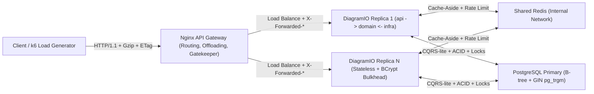

# ADR-0001: Giữ kiến trúc Layered Modular Monolith kết hợp Nginx API Gateway và Redis dùng chung cho mở rộng ngang không trạng thái

- **Trạng thái:** Accepted
- **Ngày:** 2026-11-27
- **Người đề xuất / Track:** Gate M0 — Toàn nhóm (Architecture Baseline)
- **QAS / ASR liên quan:** `QAS-PERF-01`, `QAS-PERF-02`, `QAS-PERF-03`, `QAS-SEC-01`, `QAS-SEC-02`, `QAS-AVAIL-01`, `QAS-SCALE-01`, `QAS-DEPLOY-01` (`ASR-01` – `ASR-06`)
- **Ticket liên quan:** `#1` (và làm nền cho `#2` – `#30`)

---

## 1. Bối cảnh & Vấn đề (Context & Problem Statement)

Ở Phase 1, **DiagramIO** được xây dựng theo kiến trúc 3 tầng sạch (`com.diagramio.api` -> `com.diagramio.domain` <- `com.diagramio.infrastructure`, lắp ghép tại `com.diagramio.config`) với `ArchitectureTest` (ArchUnit) khóa cứng quy tắc phụ thuộc hướng tâm và đảm bảo tầng `domain` là Java thuần. Cơ sở dữ liệu PostgreSQL quản lý 5 bảng gắn kết chặt chẽ thông qua khóa ngoại và giao dịch ACID (`users`, `refresh_tokens`, `diagrams`, `diagram_versions`, `diagram_shares`).

Bước sang Phase 2, hệ thống cần giải quyết đồng thời 4 áp lực kiến trúc:
1. Tối ưu mạnh hiệu năng đọc/ghi và tìm kiếm khi payload `JSONB` đạt **100 KB – 2 MB** trên môi trường **Kaggle CPU (4 vCPU, 31 GB RAM)**.
2. Mở rộng ngang được nhiều bản sao ứng dụng không trạng thái (stateless replicas), có cân bằng tải, Failover khi 1 bản sao dừng và cô lập tầng dữ liệu theo mẫu **Gatekeeper**.
3. Đưa trạng thái dùng chung (cache sơ đồ nóng, phân giải `X-Share-Token`, bộ đếm Rate Limiting) ra ngoài bộ nhớ JVM để các bản sao nhất quán tức thì.
4. Giữ nguyên **100% hợp đồng API `/api/v1`** và **6 bất biến từ Phase 1** (đặc biệt là kiểm quyền tập trung `DiagramAccess` + `Caller`, Optimistic Locking `409 Conflict`, khôi phục phiên bản nguyên tử `restore` và thu hồi link chia sẻ tức thì).

Câu hỏi kiến trúc nền tảng cần chốt tại cổng M0 là: **Giữ cấu trúc triển khai Layered Modular Monolith kết hợp Nginx API Gateway và Redis dùng chung, hay tái cấu trúc sang Microservices, Event Sourcing, Database Sharding hoặc Sidecar Pattern?**

---

## 2. Bằng chứng & QAS / ASR liên quan (Evidence & Related QAS / ASR)

- **Bằng chứng thực đo Phase 1 (commit `ca41f27`, Kaggle 4 vCPU / 31 GB RAM):** Với payload rỗng mặc định, 1 bản sao Spring Boot + PostgreSQL 16 đạt trần **747.49 RPS** (`p95 = 110 ms`, `0.0%` lỗi ở 100 VUs). Quá trình khảo sát mã nguồn và kịch bản tải thực tế chỉ ra các điểm nghẽn chính không nằm ở ranh giới module nghiệp vụ mà ở:
  - ORM kéo lặp cột `data` (`JSONB` tới 2 MB) lên JVM cho các API danh sách (`GET /diagrams`, `GET /diagrams/public`, `GET /diagrams/{id}/versions`), kiểm quyền `DiagramAccess`, cập nhật `PUT` và sao chép snapshot/restore.
  - Thiếu index B-tree cho `diagram_shares(diagram_id)`, `diagrams(is_public)` và index GIN `pg_trgm` cho `LIKE '%...%'` trên `title`.
  - Truy vấn lặp PostgreSQL cho từng request xem sơ đồ nóng và phân giải `X-Share-Token`.
  - Tác vụ băm BCrypt chiếm dụng CPU dùng chung khi bị Auth Flood (`QAS-SEC-01`).
- **Liên kết QAS:** Quyết định này chi phối trực tiếp các ngưỡng về hiệu năng xử lý (`QAS-PERF-01..03`), tính tức thì thu hồi quyền & chống quá tải Auth (`QAS-SEC-01..02`), khả năng failover cụm đa bản sao & degradation khi Redis lỗi (`QAS-AVAIL-01`), đo tách bạch Gateway overhead (`QAS-SCALE-01`) và triển khai Ablation bằng Feature Flags (`QAS-DEPLOY-01`).

---

## 3. Phương án được chọn (Decision Outcome / Chosen Option)

Chọn kiến trúc **Layered Modular Monolith + Nginx API Gateway + Redis Dùng Chung + Single Primary PostgreSQL**:

Cụ thể gồm 4 trụ cột thiết kế:
1. **Giữ Layered Modular Monolith trong mỗi bản sao ứng dụng:** Duy trì 1 tiến trình Spring Boot chia module rõ ràng theo nghiệp vụ (`auth`, `user`, `diagram`, `version`, `share`, `access`) và 3 tầng sạch (`api` -> `domain` <- `infrastructure`). Tầng `domain` giữ thuần Java và giao tiếp với Redis/Feature Flags thông qua Port interfaces.
2. **Mở rộng ngang không trạng thái sau Nginx API Gateway:** Nhân bản nhiều container `app` stateless sau một điểm vào duy nhất là **Nginx** nhằm hiện thực hóa 3 mẫu trong học liệu:
   - *Gateway Routing:* Cân bằng tải đều sang nhiều bản sao `app` và tự động chuyển hướng khi 1 bản sao dừng (*Active Redundancy*).
   - *Gateway Offloading:* Gánh nén Gzip tại biên, giới hạn kích thước body và chuyển tiếp `X-Forwarded-Host`/`Proto` tin cậy để sinh `shareUrl` chính xác.
   - *Gatekeeper:* Cô lập PostgreSQL và Redis hoàn toàn trong mạng Docker nội bộ ở cấu hình triển khai chuẩn.
3. **Bổ sung Redis dùng chung (Shared Redis):** Lưu trữ phân tán cho *Cache-Aside* (sơ đồ nóng và phân giải `X-Share-Token` kèm xóa cache ngay sau khi commit giao dịch DB) và *Distributed Rate Limiting* cho `/auth/*`.
4. **Giữ một nút PostgreSQL chính (Single Primary PostgreSQL) tối ưu chiều sâu:** Dùng chung CSDL cho *CQRS-lite Read Projection* (bỏ cột `JSONB` ở đường đọc danh sách và kiểm quyền), bổ sung *Index Table* (`B-tree`, `GIN pg_trgm`) và chép dữ liệu trực tiếp trong DB khi tạo snapshot/restore.

**Chiến thuật SEI & Mẫu thiết kế áp dụng:** *Restrict Dependencies* (ArchUnit), *Encapsulate / Use an Intermediary* (Ports & Adapters), *Maintain Multiple Copies of Data* (*Cache-Aside*), *Active Redundancy* (*Gateway Routing*), *Limit Exposure* (*Gatekeeper*), *Throttle* (*Rate Limiting*), *Bound Queue / Manage Demand* (*Bulkhead* + *Load Shedding*), *Defer Binding* (*Feature Flags*), *CQRS-lite*, *Index Table*.

---

## 4. Các phương án đã cân nhắc nhưng loại (Considered & Rejected Alternatives)

### Phương án A: Tách thành Microservices (Auth Service, Diagram Service, Version Service, Share Service với DB riêng)
- **Mô tả ngắn:** Chia mỗi module nghiệp vụ thành một dịch vụ Spring Boot độc lập kèm cơ sở dữ liệu riêng, giao tiếp qua REST/gRPC hoặc message broker.
- **Lý do loại:**
  1. **Phá vỡ tính gắn kết giao dịch và kiểm quyền đồng bộ (Bất biến 3 & 5):** Mọi thao tác trên sơ đồ đều hợp nhất dữ liệu người dùng (`JWT`) và quyền chia sẻ (`diagram_shares`) để chạy `DiagramAccess.require(...)` trên bảng `diagrams`. Đặc biệt, thao tác khôi phục phiên bản (`restore`) bắt buộc chèn snapshot sao lưu vào `diagram_versions` và ghi đè `diagrams` trong **cùng một giao dịch ACID**. Nếu tách DB, kiểm quyền sẽ biến thành nhiều cuộc gọi mạng RPC làm tăng độ trễ đuôi (`p99`), còn `restore` phải chuyển thành mẫu Saga/2PC phức tạp, dễ phát sinh trạng thái dở dang khi lỗi.
  2. **Lãng phí tài nguyên trên quỹ 4 vCPU của Kaggle:** Khởi chạy 4–5 JVM Spring Boot riêng lẻ cùng service discovery/broker sẽ ngốn nhiều GB RAM nền và CPU chuyển đổi ngữ cảnh/serialization nội bộ, làm giảm mạnh thông lượng thực tế so với một Modular Monolith tối ưu.

### Phương án B: Event Sourcing (Lưu chuỗi sự kiện thay đổi sơ đồ thay cho trạng thái `DiagramData` hiện tại)
- **Mô tả ngắn:** Lưu toàn bộ thao tác chỉnh sửa dưới dạng append-only event log trong Event Store, dựng lại trạng thái sơ đồ bằng event replay hoặc chiếu bất đồng bộ (async projection) sang bảng đọc.
- **Lý do loại:**
  1. **Không phù hợp hợp đồng API và phạm vi Phase 1/2:** Hợp đồng API Phase 1 là mô hình trạng thái (state-based): `PUT /api/v1/diagrams/{id}` nhận toàn bộ `{ "nodes": [...], "edges": [...] }` kèm `version` kiểm tra `409 Conflict`, còn `diagram_versions` lưu snapshot cố định; dự án cũng không làm cộng tác thời gian thực CRDT/OT/WebSocket.
  2. **Đánh đổi Eventual Consistency gây rủi ro sai nghiệp vụ:** Chiếu trạng thái bất đồng bộ từ Event Store sang Read Model tạo ra trễ đồng bộ đọc-sau-ghi (`read-after-write`), đe dọa trực tiếp trải nghiệm sau `PUT`/`restore` và độ chính xác của `ETag`. Nút thắt thật sự (chở lặp 2 MB `JSONB` lên JVM) đã được giải quyết triệt để và đơn giản hơn nhiều bằng **CQRS-lite Projection** và chép `JSONB` nội bộ trong PostgreSQL (`#29`).

### Phương án C: Database Sharding (Phân mảnh ngang PostgreSQL)
- **Mô tả ngắn:** Tách bảng `diagrams`, `diagram_versions`, `diagram_shares` ra nhiều nút PostgreSQL độc lập theo `owner_id` hoặc `diagram_id`.
- **Lý do loại:**
  1. **Gây truy vấn tán xạ (Scatter-Gather) cho các luồng cốt lõi:** Endpoint `GET /api/v1/diagrams/public` cần lọc `is_public = true` và sắp xếp `updated_at DESC` trên toàn hệ thống; nếu shard theo `owner_id`, mỗi lần xem trang công khai phải truy vấn tất cả các shard rồi trộn kết quả. Ngược lại, nếu shard theo `diagram_id`, danh sách `GET /diagrams` của một người dùng cũng bị tán xạ ra nhiều shard; còn `GET /shares/{token}` lại chỉ có `share_token` mà chưa biết `diagram_id`.
  2. **Không cần thiết ở quy mô mục tiêu:** Sau khi bổ sung index và loại bỏ tải thừa cột `JSONB`, một nút PostgreSQL 16 với HikariCP tinh chỉnh hoàn toàn đáp ứng dư dả tải mục tiêu trên phần cứng 4 vCPU mà vẫn giữ nguyên vẹn khóa ngoại `ON DELETE CASCADE`.

### Phương án D: Sidecar Pattern (Gắn container proxy/cache phụ trợ cạnh từng bản sao ứng dụng)
- **Mô tả ngắn:** Triển khai một container Sidecar (như Envoy/proxy cục bộ) đi kèm riêng từng replica `app` để xử lý định tuyến, TLS/CORS, nén hoặc thu thập telemetry.
- **Lý do loại:**
  1. **Dư thừa hop mạng và CPU trên môi trường đồng nhất:** Sidecar phù hợp với hệ sinh thái Microservices đa ngôn ngữ trên Kubernetes/Service Mesh. Với DiagramIO là một Modular Monolith đồng nhất viết bằng Java 21 / Spring Boot trên Docker Compose, gắn thêm Sidecar cho từng bản sao sẽ nhân đôi số container, tăng thêm hop loopback không cần thiết và tranh chấp CPU trên cùng máy 4 vCPU.
  2. **Phân vai rõ ràng hơn với Nginx Gateway + In-Process Libraries:** Các tác vụ biên dùng chung (Routing, Offloading Gzip, Gatekeeper) gom về **1 Nginx Gateway** duy nhất; các tác vụ gắn chặt với tiến trình JVM (Actuator/Micrometer Prometheus, Bulkhead BCrypt, Port/Adapter Redis) chạy trực tiếp trong ứng dụng với độ trễ gần bằng `0`.

---

## 5. Hệ quả & Đánh đổi (Consequences & Trade-offs)

### Tích cực (Benefits)
- Bảo toàn 100% ranh giới 3 tầng sạch (`ArchitectureTest` xanh), giao dịch ACID nguyên vẹn cho `restore` và `refresh-token` rotation, không phát sinh nợ kỹ thuật phân tán (distributed transactions/RPC).
- Mở rộng ngang đơn giản bằng `docker compose up --scale app=N` đứng sau Nginx Gateway, đạt Failover chủ động và cô lập mạng dữ liệu (Gatekeeper).
- Cho phép đo đạc khoa học kiểu **Ablation (`C0 -> Full`)** nhờ Feature Flags trên cùng một codebase thống nhất.

### Tiêu cực & Đánh đổi (Costs, Risks & Mitigations)
- **Độ trễ hop mạng qua Nginx Gateway (`QAS-SCALE-01`):** Mọi request đi qua Gateway chịu thêm chi phí reverse proxy cục bộ. *Giảm thiểu:* Đo đối chứng trung thực `Direct` vs `Via Nginx` trong `#26`; tận dụng Nginx keepalive tới upstream và nén Gzip tại biên để bù đắp băng thông.
- **Phụ thuộc vận hành thêm Redis (`QAS-AVAIL-01`, `QAS-SEC-02`):** Thêm Redis làm tăng yêu cầu đồng bộ cache và xử lý lỗi mạng Redis. *Giảm thiểu:* Bắt buộc dùng **after-commit eviction** khi sửa/xóa sơ đồ hoặc thu hồi `X-Share-Token`; cài cơ chế **Graceful Degradation** (rơi về PostgreSQL cho đường đọc và fail-open có log/metric cho Rate Limiter) để đảm bảo **0 lỗi `500`** khi Redis gặp sự cố.
- **Giới hạn ghi trên 1 nút PostgreSQL Primary:** Tất cả bản sao `app` ghi vào cùng 1 PostgreSQL. *Giảm thiểu:* Giải phóng tải đọc cho PostgreSQL bằng Redis Cache-Aside và CQRS-lite Projection, rút ngắn thời gian giữ khóa dòng (`#29`) và giới hạn kích thước pool HikariCP trên mỗi bản sao (`#17`) để không quá tải `max_connections`. (Nếu trong tương lai tải đọc vượt ngưỡng 1 nút DB, kiến trúc hiện tại đã tách Read Model rõ ràng nên có thể nối thêm PostgreSQL Read Replica mà không phải viết lại `domain`).

---

## 6. Cách kiểm chứng & Tiêu chí nghiệm thu (Verification & Compliance)

- **Kiểm thử tự động:**
  1. Chạy `./mvnw test -Dtest=ArchitectureTest` để xác nhận tầng `domain` không phụ thuộc framework web/DB/Redis/Spring nào.
  2. Chạy toàn bộ `./mvnw test -Dtest='com.diagramio.e2e.**'` trực tiếp vào app và qua cổng **Nginx API Gateway** (`#18`) ở cả trạng thái tắt và bật các Feature Flags.
- **Đo kiểm định lượng:**
  1. Trong cụm `Nginx + ≥ 2 App + Redis + PostgreSQL`, thực hiện thu hồi `X-Share-Token` ở Node A và kiểm tra Node B trả `404` ngay lập tức; dừng đột ngột 1 container `app` giữa lúc chạy tải để xác nhận failover và dịch vụ không sập toàn cục.
  2. Chạy trọn bộ kịch bản `S1–S4` trên cùng 1 phiên Kaggle Notebook 4 vCPU từ mốc `C0` -> `Track 1` -> `Track 2` -> `Track 3` -> `Nginx + Multi-instance` (`#26`), đối chiếu định lượng với bảng QAS trong [docs/phase2/README.md](../phase2/README.md).
